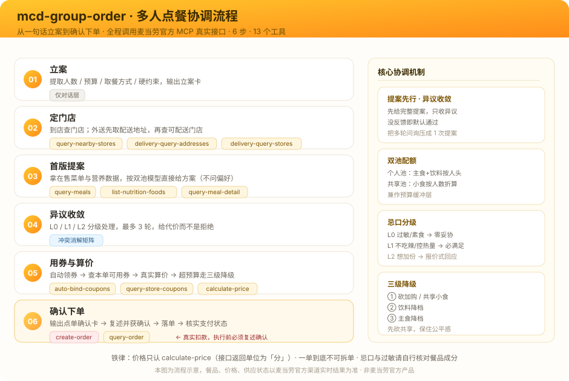

# 🍔 mcd-group-order · 麦当劳聚餐点餐协调器

> **6 个人，预算 150 元，有人不吃辣，有人想控制热量——一句话，AI 帮你把这一单协调完并下单。**

[](https://github.com/ljbljb007/mcd-group-order)
[](./LICENSE)
[](https://github.com/M-China/mcd-mcp-server)
[](https://github.com/M-China/mcd-developer-innovation-challenge)
[](https://github.com/ljbljb007/mcd-group-order)

**仓库地址**：https://github.com/ljbljb007/mcd-group-order

<details>
<summary><b>English</b> — What is this? （点击展开）</summary>

A coordination Skill for **ordering McDonald's for a group**, built on McDonald's China's official MCP server.

Group ordering doesn't fail because people can't decide what to eat — it fails because coordinating N people is expensive. This Skill handles the coordination layer end to end: it proposes a complete plan first instead of polling everyone's preferences, absorbs objections, resolves conflicts (spicy vs. non-spicy, calorie counters vs. everyone else, budget overruns), splits items into per-person and shared pools, auto-claims coupons, calls the real pricing API, and finally places **one consolidated order**.

```text
"6 people, ¥150 budget, one person doesn't eat spicy, two are counting calories — order for us."
```

Powered by 13 real MCP tools (`query-meals`, `calculate-price`, `create-order`, …), so everything in the plan is actually orderable at that store, at that price, right now.

</details>

---

## 📌 目录

- [一图看懂流程](#-一图看懂从一句话到一单)
- [为什么需要它](#-为什么需要它多人点餐的成本在哪)
- [30 秒上手](#-30-秒上手)
- [使用示例](#-使用示例)
- [核心机制](#-核心机制)
- [适用场景](#-适用场景)
- [用到的 MCP 能力](#-用到的-mcp-能力)
- [目录结构](#-目录结构)
- [常见问题](#-常见问题)
- [设计取舍](#-设计取舍)
- [更新日志](#-更新日志)
- [支持本项目](#-支持本项目)

---

## 🧭 一图看懂：从一句话到一单

<picture>
  <source media="(prefers-color-scheme: dark)" srcset="./assets/architecture.png">
  
</picture>

> 左侧是六步流程（每步标注用到的 MCP 工具），右侧是四个核心协调机制。铁律：价格只认 `calculate-price`，一单到底不可拆单，`create-order` 前必须复述确认。

---

## 😩 为什么需要它：多人点餐的成本在哪

一个人点麦当劳，30 秒。六个人点麦当劳，会变成这样：

| 你现在的做法 | 用本 Skill |
|---|---|
| 群里问一遍「你想吃什么」，一半人回「随便」 | **0 次问询**，AI 直接甩一份完整提案 |
| 有人不吃辣、有人非辣不吃，吵不出结果 | 主餐统一不辣，辣味做成共享小食 / 辣酱另附 |
| 有人控热量，有人觉得管太多 | 分人配额 + 热量标注**到人头**，不是给个平均值糊弄 |
| 算完发现超预算，砍谁的都不合适 | 三级降级：**砍加购 → 饮料降档 → 主食降档**，保住公平感 |
| 有人临时改主意，前面白聊 | 异议最多 3 轮，之后 AI 给「二选一」让你拍板 |
| 手动查券、手动算总价 | 自动领券 + `calculate-price` 真实券后价 |

**这些问题的共同点是：它们都不是"选餐"问题，是"协调"问题。**

而这个 Skill 的全部设计，都压在协调上——它不是一个「菜单推荐器」。

---

## ⚡ 30 秒上手

### 前置条件

1. 申请麦当劳中国 MCP Token：[mcd-mcp-server 使用指南](https://github.com/M-China/mcd-mcp-server)
2. 复制 [`mcp-config.example.json`](./mcp-config.example.json) 的内容，把 `${MCD_MCP_TOKEN}` 换成你的 Token

### 在 WorkBuddy 中使用（推荐）

1. 左侧边栏【专家·技能·连接器】→【连接器】→ 右上角【自定义连接器】→【配置 MCP】
2. 粘贴配置 → 保存 → 回到列表把 `mcd-mcp` **启用**
3. 安装 Skill：

   ```bash
   # 用户级（所有项目可用）
   cp -r mcd-group-order ~/.workbuddy/skills/
   ```

4. 重启 WorkBuddy，直接说：**「6个人，预算150元，有人不吃辣，帮我们点一单」**

> 其他支持 Skill 机制的客户端同样适用：`SKILL.md` 为标准格式（`name` + `description` frontmatter + Markdown 编排），`references/` 由 Agent 按需加载。

---

## 💬 使用示例

**你说：**

> 6 个人，预算 150 元，有人不吃辣，有人想控制热量，帮我们点一单。

**AI 回立案卡：**

```
📋 立案
6人 · 预算¥150（人均¥25）· 麦乐送到 [你的地址]
硬约束：有人不吃辣 · 有人控热量

→ 只补问两个真正影响方案的项（送到哪、热量控制在多少），
  不逐个问 6 个人想吃什么。
```

**然后甩出首版提案：**

```
🍔 首版提案（6人 · ¥150）

【个人池】
  板烧鸡腿堡  ×2   约 480 kcal / 份
  麦香鱼      ×2   约 400 kcal / 份
  吉士汉堡    ×2   约 300 kcal / 份
  可乐        ×3 · 无糖可乐 ×3

【共享池】
  大薯 ×2 · 麦乐鸡(5块) ×3 · 玉米杯 ×2

🚫 硬约束
  不吃辣 ✓（全部主餐不辣，辣味单独处理）
  控热量 ✓（已给 2 人配低卡组合）

—— 有异议直接说，没意见我就按这个算价下单。
```

**有异议时，AI 给代价而不是拒绝：**

> 同事 B：我想吃麦辣鸡翅。

```
加一份麦辣鸡翅 +¥12，总价 ¥158，超预算 ¥8。
砍掉 1 份大薯（−¥9）可以抵消。要这么调吗？
顺带说明：鸡翅放共享区，不吃辣的同事不受影响。
```

**自动领券 + 真实算价：**

```
🎟️ 帮你领了 3 张券，本单可用「满100减15」
💰 原价 ¥161.50 → 券后 ¥146.50 ✅ 预算内，人均 ¥24.4
```

**产出确认卡，你确认才下单：**

```
✅ 聚餐点单确认卡
━━━━━━━━━━━━━━━━━━━━━━━━━━━
👥 6人 · 麦乐送 · [门店]
💰 预算 ¥150 → 实付 ¥146.50（人均 ¥24.4）
🎟️ 已用券：满100减15（省 ¥15）
🚫 硬约束：不吃辣 ✓ | 控热量 2人 ✓
🔥 热量：人均约 745 kcal（控热量者 A 620 / B 580）

【个人池】板烧鸡腿堡×3 / 吉士汉堡×2 / 麦香鱼×1
         可乐×3 / 无糖可乐×3
【共享池】大薯×1 / 麦乐鸡5块×3 / 玉米杯×2 / 麦辣鸡翅×1

💳 AA：每人 ¥24.4
━━━━━━━━━━━━━━━━━━━━━━━━━━━
回复「确认下单」我就提交；要改直接说改哪。
```

确认后 `create-order` 真实落单，支付后用 `query-order` 核实状态。完整对话见 [`examples/sample-session.md`](./examples/sample-session.md)。

---

## 🧠 核心机制

### 1. 提案先行 + 异议收敛

逐个问「你想吃什么」在多人场景必然失败：6 人 × 3 轮 = 18 次往返，且答案互相冲突。

反过来做：**先给完整提案，再收异议，没反馈即默认通过。** 异议变成「相对于方案的偏差」，认知负担从"从零想吃什么"降到"这一条我同意吗"。

### 2. 双池配额：个人池 + 共享池

聚餐和单人点餐的本质区别——有些东西该人手一份，有些东西该共享。

| 池 | 内容 | 数量规则 |
|---|---|---|
| **个人池** | 主食 + 饮料 | 严格按人头 1 份 |
| **共享池** | 薯条 / 麦乐鸡 / 鸡翅 / 玉米杯 | `ceil(人数÷2)` ~ `ceil(人数×0.7)` 份 |

同样预算下，共享池让种类更丰富、浪费更少，而且它天然是**预算缓冲层**——超预算先砍它，不动「每个人都有份」的公平感。

### 3. 忌口分级：硬约束零妥协

| 级别 | 内容 | 处理方式 |
|---|---|---|
| **L0** | 过敏、宗教禁忌、素食 | 违反即方案作废，无条件替换 |
| **L1** | 不吃辣、控热量、不喝碳酸 | 必须满足，影响主食与饮料选择 |
| **L2** | 想加份、想换某单品 | 报价式回应，决策权交发起人 |

### 4. 冲突消解内置

| 冲突 | 解法 |
|---|---|
| 有人不吃辣 + 有人要辣 | 主餐统一不辣，辣味做成共享小食或辣酱另附 |
| 有人控热量 + 别人不控 | 分人配额 + 热量标注到人头 |
| 预算不够 | 三级降级，且**优先砍共享池而非个人主食** |
| 有人要双份 / 有人不吃主食 | 个人配额可转让，不挤占他人 |
| 迟迟不回复 | 默认同意制兜底，不无限等待 |

详见 [`references/conflict-resolution.md`](./references/conflict-resolution.md)。

---

## 🎯 适用场景

| 场景 | 典型说法 | 本项目替你解决 |
|---|---|---|
| **办公室工作餐 / 加班餐** | 「帮我们部门 12 个人订个麦当劳，人均 35」 | 出餐快、易分食；支持企业团餐查满减 |
| **宿舍夜宵** | 「宿舍 4 个人凑一单，预算 80」 | 预算敏感，共享装最划算 |
| **朋友聚会** | 「我们 5 个人周末聚餐，丰富点」 | 共享池加大，丰富度优先 |
| **团建 / 生日会** | 「10 个人，先垫一顿」 | 派对 / 生日会可衔接 `party-order-create` 链路 |

---

## 🔧 用到的 MCP 能力

共 13 个 `mcd-mcp` 工具，覆盖从选店到支付核实全流程：

| 阶段 | 工具 |
|---|---|
| 定门店 | `query-nearby-stores` · `delivery-query-addresses` · `delivery-query-stores` |
| 出提案 | `query-meals` · `query-meal-detail` · `list-nutrition-foods` |
| 用券 | `available-coupons` · `auto-bind-coupons` · `query-store-coupons` |
| 算价下单 | `calculate-price` · `create-order` · `query-order` |
| 团餐追加 | `query-promotions` · `query-meal-assistance` |

**为什么必须用真实 MCP**：菜单会变、门店定价不同、卡包里的券不等于这单能用。只有实时接口能保证——**方案里的东西一定点得到，报出来的价一定是真实券后价，最后真的能落成一单。**

完整链路与参数踩坑点见 [`MCP_INTEGRATION.md`](./MCP_INTEGRATION.md)。

---

## 📂 目录结构

```text
mcd-group-order/
├── README.md                     项目介绍（本文件）
├── SKILL.md                      Skill 主体：五阶段流程 + 冲突消解 + 确认卡
├── MCP_INTEGRATION.md            MCP 调用链路与业务价值
├── CONTEST_DECLARATION.md        参赛声明（官方原文，未改动）
├── mcp-config.example.json       脱敏 MCP 配置示例（仅环境变量占位符）
├── workbuddy.md                  WorkBuddy 开发对话上下文
├── LICENSE                       MIT
├── assets/
│   ├── architecture.svg          六步协调流程图（README 用）
│   └── architecture.png          流程图 2x PNG（兼容性备用）
├── references/                   按需加载的参考
│   ├── menu-planning.md          双池配额算法、人均档位、热量控制清单
│   ├── conflict-resolution.md    冲突矩阵、异议话术、收敛失败处理
│   └── ordering-flow.md          MCP 工具调用链路与参数踩坑点
└── examples/
    └── sample-session.md         完整对话样例
```

---

## ❓ 常见问题

**Q：为什么不问每个人想吃什么？**
A：问了等于没问——多人场景的高频回答是「随便」，而且答案互相冲突。「提案 + 异议」把 N×M 次问询压缩成 1 次提案 + ≤3 轮偏差修正。

**Q：能分开付钱吗？**
A：不能。MCP 一次只能下一单，「统一下单」就是一张订单包含所有人。AA 是**线下收款**——确认卡会直接给出人均金额方便你收。

**Q：有人不吃辣，AI 会怎么处理？**
A：三步走——① 优先选本身不辣的单品；② 用 `query-meal-detail` 查能否特调去辣酱；③ 都不行就明说并给替代方案。**不会为了凑单让不吃辣的人将就。**

**Q：热量数字准吗？**
A：来自 `list-nutrition-foods` 的官方营养数据，但那是常见餐品的静态数据，与门店在售可能不完全一致。**仅供参考，不构成营养或医疗建议**；数据缺失的单品标注「热量未知」，不编数字。

**Q：会和官方的「麦当劳点餐助手」冲突吗？**
A：按人数路由。一人点餐 / 查菜单 / 领券 / 查积分 / 查订单 → 用 `mcdonald-assistant`；**两人及以上**需要协调忌口与预算 → 用本 Skill。两者同时被唤起时以「涉及人数 ≥ 2」为准。

**Q：预算超了会怎样？**
A：不会报错，走三级降级：砍随单购 / 加购 → 饮料降档 → 主食降档。每级都告诉你砍了什么、省了多少。

---

## ⚖️ 设计取舍

- **不无限收敛**。异议上限 3 轮，之后把「未解决项 + 建议 + 二选一」摆给你拍板。协调器的价值是缩短决策，不是替人决策。
- **不编造数字**。价格只认 `calculate-price`，热量只认 `list-nutrition-foods`，缺了就标「未知」。
- **不替你付钱**。`create-order` 是真实扣款动作，执行前必须复述订单全文并获明确确认。
- **不追求最优解**。协调场景里，"够好且大家都能接受"比"理论最优"更实用。

---

## 🗓️ 更新日志

- **2026-10-30** — README 重写（双语简介 / 目录 / 对比表 / FAQ / 取舍说明）；SKILL 补充与 `mcdonald-assistant` 的路由分工
- **2026-10-23** — 项目首发并完成参赛报名（Issue #1120，官方已确认「成功参赛」）

详见 [CHANGELOG.md](./CHANGELOG.md)。

---

## ⭐ 支持本项目

如果觉得有用，**点个 Star** 就是最大的支持 ⭐

也欢迎：

- 提 Issue 反馈真实聚餐中遇到的冲突类型，我会补充到消解矩阵里
- PR 补充更多地区 / 门店的实测样例
- 把你的真实对话贴到 [`examples/sample-session.md`](./examples/sample-session.md)

---

## 📄 免责声明

本项目为麦当劳程序员节创意开发大赛参赛作品，由参赛者独立开发，**非麦当劳官方产品**。

项目输出仅供参考，**不构成医疗、营养或其他专业建议**；餐品信息、价格及供应状态以麦当劳官方渠道的实时结果为准。过敏等高风险忌口请自行核对餐品成分。

---

## 🔗 相关链接

- 仓库：https://github.com/ljbljb007/mcd-group-order
- MCP Server：[mcd-mcp-server](https://github.com/M-China/mcd-mcp-server)
- 开发工具：[Codex](https://chatgpt.com/))

---

MIT © 2026 ljbljb007 · 详见 [LICENSE](./LICENSE)
